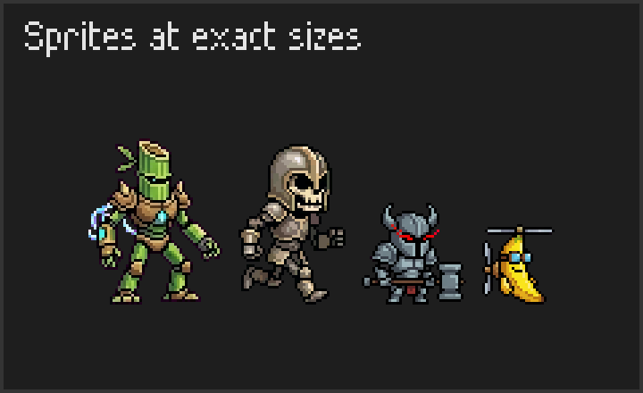
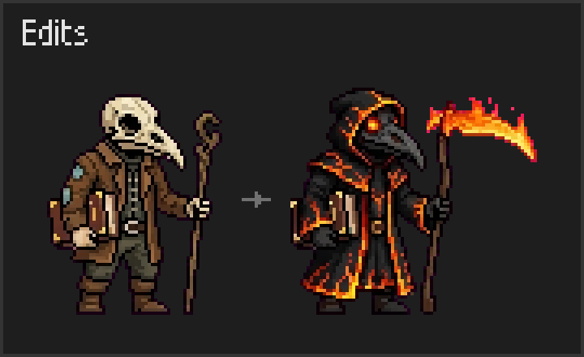
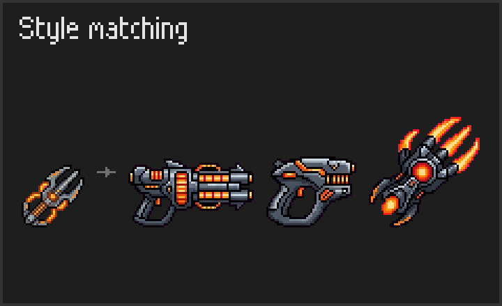
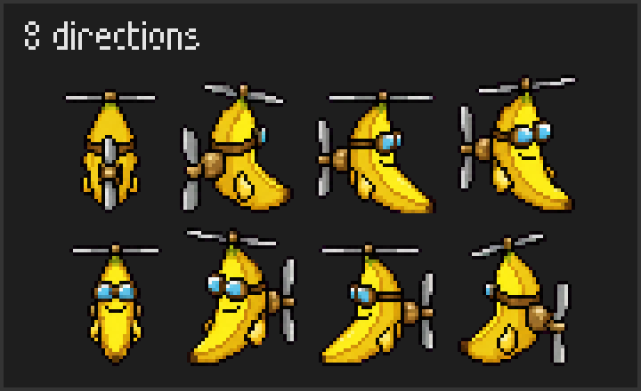
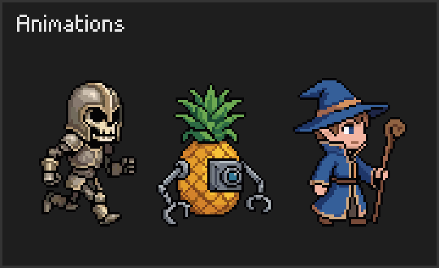
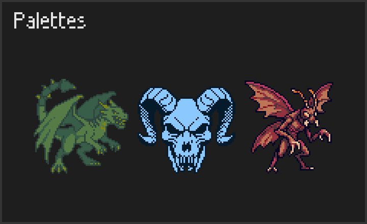
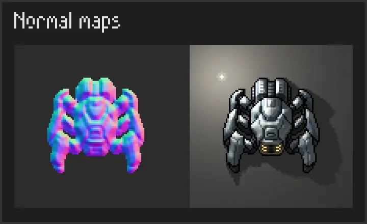
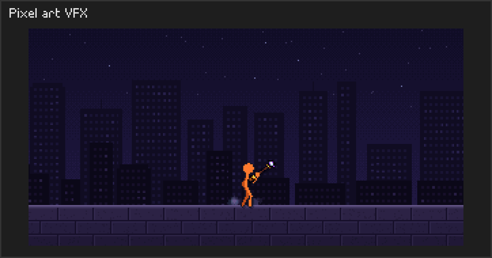

# Sprite Fusion Skills

Game-ready pixel art assets: sprites at exact sizes, edits, style matching, 8 directions, animations, palettes, normal maps, and pixel art VFX, saved into your game project.

Agent skills and a Claude Code plugin for [Sprite Fusion](https://www.spritefusion.com/pixel-art-generator).

<p>
<a href="https://www.spritefusion.com/docs/pixel-art-generator/quick-start"></a>
<a href="https://www.spritefusion.com/docs/pixel-art-generator/edit-your-pixel-art"></a>
<a href="https://www.spritefusion.com/docs/pixel-art-generator/generate-pixel-art-with-style-consistency"></a>
<a href="https://www.spritefusion.com/docs/pixel-art-generator/generate-8-directions-for-your-pixel-art"></a>
<a href="https://www.spritefusion.com/docs/pixel-art-generator/animation-tips"></a>
<a href="https://www.spritefusion.com/docs/pixel-art-generator/color-palettes"></a>
<a href="https://www.spritefusion.com/docs/pixel-art-generator/generate-normal-maps"></a>
<a href="https://www.spritefusion.com/pixel-art-vfx"></a>
</p>

## Get started

```bash
npx spritefusion setup
```

The [setup CLI](https://github.com/Sprite-Fusion/spritefusion-cli) connects Sprite Fusion to the agents on your machine (Claude Code, Codex, Cursor, VS Code and Copilot CLI, Windsurf, Gemini CLI, and OpenCode) and adds the skills. You sign in to Sprite Fusion in your browser: no API key is needed.

Then ask your agent for what your game needs:

```text
Make a 32 pixel brass dungeon key and save it in assets/sprites.
Animate the knight walking.
Turn the knight into 8 directions.
Make new enemies in the style of slime.png.
Create normal maps for every sprite in assets/sprites.
Add a fireball effect to my game.
```

## Skills

| Skill | For |
| --- | --- |
| [spritefusion-pixel-art](skills/spritefusion-pixel-art/SKILL.md) | Sprites at exact sizes, edits, tags, and saving results into your project |
| [spritefusion-animation](skills/spritefusion-animation/SKILL.md) | Idle, walk, run, and attack animations, from the right starting pose |
| [spritefusion-8-directions](skills/spritefusion-8-directions/SKILL.md) | Eight directional views of a sprite |
| [spritefusion-style-consistency](skills/spritefusion-style-consistency/SKILL.md) | New sprites in the style of your existing art |
| [spritefusion-palettes](skills/spritefusion-palettes/SKILL.md) | Sprites in a palette, and recoloring the ones you have |
| [spritefusion-normal-maps](skills/spritefusion-normal-maps/SKILL.md) | Normal maps for 2D lighting in Godot, Unity, and Unreal Engine |
| [spritefusion-pixel-vfx](skills/spritefusion-pixel-vfx/SKILL.md) | Pixel art effects as code, from the VFX library |
| [spritefusion-godot](skills/spritefusion-godot/SKILL.md) | Normal-mapped lights and tilemap export in Godot |
| [spritefusion-unity](skills/spritefusion-unity/SKILL.md) | URP 2D lights and tilemap export in Unity |

## Other ways to install

The skills only:

```bash
npx skills add Sprite-Fusion/spritefusion-skills
```

The Claude Code plugin, with the skills and the Sprite Fusion MCP server:

```text
/plugin marketplace add Sprite-Fusion/spritefusion-skills
/plugin install spritefusion@spritefusion
```

Then run `/mcp` and sign in to Sprite Fusion.

The MCP server on its own:

```bash
# Claude Code
claude mcp add --transport http --scope user spritefusion https://www.spritefusion.com/mcp

# Codex
codex mcp add spritefusion --url https://www.spritefusion.com/mcp
codex mcp login spritefusion
```

For Claude, ChatGPT, Cursor, VS Code, and other clients, see [MCP Server](https://www.spritefusion.com/docs/pixel-art-generator/api/mcp).

## Links

- [AI Agents](https://www.spritefusion.com/docs/ai-agents)
- [MCP Server](https://www.spritefusion.com/docs/pixel-art-generator/api/mcp)
- [HTTP API](https://www.spritefusion.com/docs/pixel-art-generator/api), for scripts and CI
- [Pixel art VFX](https://www.spritefusion.com/pixel-art-vfx)

## License

MIT
